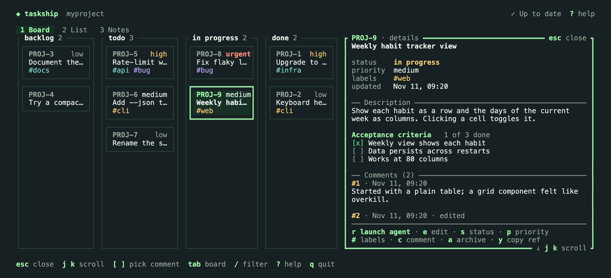

# Taskship

<p align="center">
  <picture>
    <source media="(prefers-color-scheme: dark)" srcset="docs/images/logo-dark.svg">
    
  </picture>
</p>

<p align="center"><strong>From task to agent, in one command.</strong></p>

<p align="center">
  <a href="https://github.com/jhdenham/taskship/actions/workflows/ci.yml"></a>
  <a href="https://github.com/jhdenham/taskship/releases/latest"></a>
  <a href="go.mod"></a>
  <a href="LICENSE"></a>
</p>

<p align="center">
  <a href="https://taskship.dev">Website</a> ·
  <a href="docs/quickstart.md">Quickstart</a> ·
  <a href="docs/overview.md">Docs</a> ·
  <a href="docs/roadmap.md">Roadmap</a>
</p>

Taskship is a local-first task manager and coding-agent dispatcher for developers. Organize projects and tasks from a CLI or TUI, then launch a coding agent such as Claude with the task's context. The agent reviews the task and proposes a plan before changing any code.

<p align="center">
  
</p>

> **Status:** early development. v0.1 is out: the CLI, terminal UI and Claude Code launching work today. `docs/` also describes planned features, and the [roadmap](docs/roadmap.md) says which release each one belongs to.

## Install

```sh
curl -fsSL https://taskship.dev/install.sh | sh
```

This installs the `taskship` binary for macOS or Linux in `~/.local/bin`; see the [quickstart](docs/quickstart.md) for options, or build from source with `go install github.com/jhdenham/taskship/cmd/taskship@latest`. The script lives in `website/public/install.sh`. `taskship upgrade` installs a newer release in place; a build from source updates with `go install` or a rebuild instead.

Data is stored in `~/.taskship/` (override with `TASKSHIP_HOME`), which is created by the first command that needs it.

## Quick start

```sh
cd ~/code/myproject
taskship init                          # set up a project for this repository
taskship add "Build a weekly habit tracker"
taskship refine PROJ-1                 # have an agent make the task ready to work on
taskship PROJ-1                        # launch an agent on it, plan first
taskship                               # browse tasks on a board
```

See the [quickstart](docs/quickstart.md) for more, and [tasks](docs/tasks.md), [launching agents](docs/launching.md) and the [terminal UI](docs/tui.md) for the details.

## Principles

- **Local-first.** SQLite by default, with no server or account. A self-hosted server is optional (v0.2).
- **Useful without agents.** Task management stands on its own.
- **Plan-first dispatch.** By default the agent assesses readiness and asks for approval before implementing.
- **Leave no trace.** Taskship never writes files into the repositories it manages. Its own state lives under `~/.taskship/`.
- **One Go binary.** The CLI, TUI and the future `taskship server` ship in a single executable.

## Roadmap

| Version | Focus |
|---|---|
| v0.1 | Standalone: SQLite, CLI/TUI, projects and tasks, plan-first Claude dispatch |
| v0.2 | Shared server: a self-hosted Go API with PostgreSQL, shared across machines |
| v0.3 | More agents: launching Codex, a default agent, structured plans |
| v0.4 | External task providers: GitHub Issues and Linear |

## Development

Requires Go (see `go.mod` for the version).

```sh
go build -o bin/taskship ./cmd/taskship
./bin/taskship --version

go test ./...
go vet ./...
gofmt -l .
```

Release builds set the version with `-ldflags "-X main.version=v0.1.0"`. `go install` builds report the module version.

### Repository layout

```text
cmd/taskship/       main package for the taskship binary
internal/cli/       Cobra command tree, exit codes, output
internal/core/      domain types and validation
internal/store/     SQLite persistence and embedded migrations
internal/workspace/ project and workspace resolution from directories and Git metadata
internal/dispatch/  agent runs: workspace choice, the plan-first prompt, launch
internal/display/   text formatting shared by the CLI and TUI: ~ paths, section rules
internal/editor/    opening text in $VISUAL or $EDITOR
internal/tui/       the terminal UI (Bubble Tea)
docs/               user-facing documentation (planned behavior)
website/            Astro site for taskship.dev; renders docs/ as its docs pages
```

Planned additions: `internal/` packages for the domain, storage, dispatch and server code.

### Releasing

Push a `v*` tag and `.github/workflows/release.yml` runs GoReleaser, which publishes a GitHub release with the archives and `checksums.txt` that `install.sh` downloads. Tags with a suffix, such as `v0.1.0-rc.1`, are published as pre-releases and don't become the latest release.

To check a release build locally without publishing anything:

```sh
go run github.com/goreleaser/goreleaser/v2@latest release --snapshot --clean
```

The archive names are fixed by `install.sh`. Don't change them in `.goreleaser.yaml` without updating the script.

### Website

The site in `website/` is built with [Astro](https://astro.build) and requires Node 22 or later (`website/.nvmrc` pins the version for `nvm use`).

```sh
cd website
npm ci
npm run dev       # local server at http://localhost:4321
npm run build     # static site in website/dist/
```

The docs pages are rendered from `docs/*.md` in place, so edit the docs there. `website/src/nav.ts` sets the sidebar order and must list every file in `docs/`; the build fails otherwise. CI builds the site on pushes to main and on pull requests.

## License

[Apache License 2.0](LICENSE)
