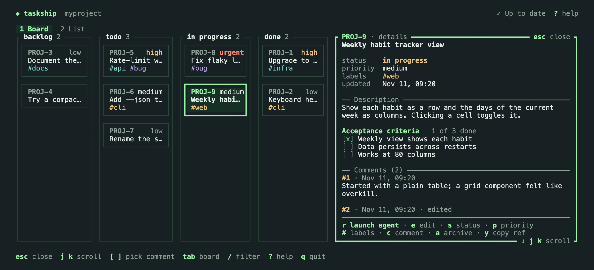

# What is Taskship?

Taskship is a local-first task manager and agent dispatcher for developers. Organize projects and tasks with a CLI or TUI, then launch a coding agent to refine a task or build it, with the task's context, in one command.

> Taskship is in early development. It launches Claude Code today, and launching Codex is planned next; the [Taskship skill](skill.md) already works in both. Pages and sections marked as planned describe features that aren't built yet, and the [roadmap](roadmap.md) lists what's coming.

## Why Taskship

A coding agent is only as good as the brief it starts from. Most work starts somewhere that makes a poor brief: a thought you meant to come back to, a `TODO` comment, a notes file you keep out of the repository, or an issue tracker in a browser tab. Taskship keeps tasks where you already work, in the terminal, and turns any of them into a brief with one command.

- **Capture:** add work as it comes up, from any folder of the repository, or by asking the agent you're already talking to.
- **Refine:** have an agent turn a rough idea into a task that's ready to work on, with acceptance criteria, before anyone touches the code.
- **Launch:** start an agent on the task, in the right folder, with instructions to plan first and wait for your approval.
- **Keep the record:** the agent's summary becomes a comment, the task knows which run finished it, and every run can be resumed.

## Principles

- **Local-first.** One SQLite database under `~/.taskship`, with no server or account. A self-hosted server for sharing tasks across machines is optional and planned.
- **Useful without agents.** Task management stands on its own: a fast CLI, a TUI, JSON output for scripts, and tasks as Markdown.
- **Plan-first.** By default the agent assesses the task and proposes a plan, and changes nothing until you approve it.
- **Task text is data, not instructions.** Tasks are fenced off in the agent's prompt as untrusted, and the prompt never carries configuration, environment variables, or credentials.
- **Leave no trace.** Taskship never writes files into the repositories it manages, so there's nothing to commit or ignore.
- **One binary.** The CLI, the TUI, and the future server ship in a single executable.
