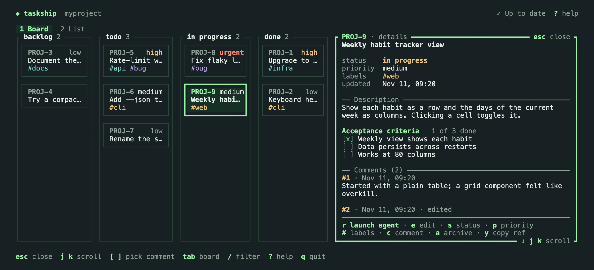
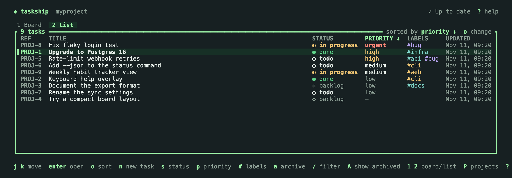
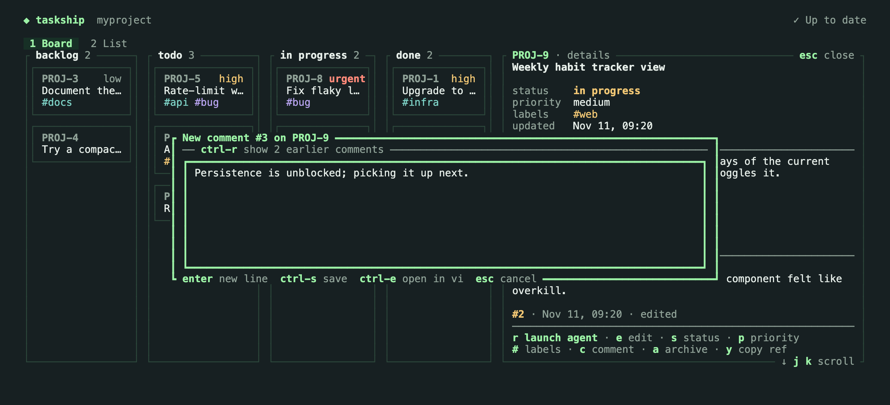
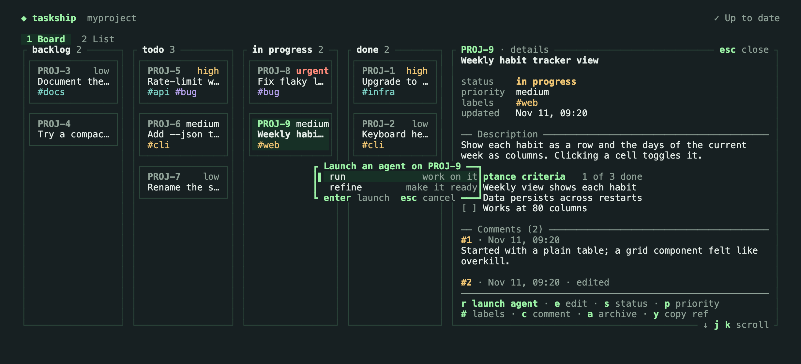

# Terminal UI

Run `taskship` with no arguments, or `taskship tui`, to open a full-screen view of your project's tasks. Everything you can do to a task from the command line, you can do here: browse, filter, add, edit, comment, archive, and launch an agent. Both the keyboard and the mouse work.

The TUI needs a terminal. Without one (in a pipe or a script), `taskship` prints its help instead, and `taskship tui` fails with exit code 2. It needs at least 80 × 24; in a smaller window it asks you to make it bigger.

## Which project it shows

The TUI opens on the project of the current folder, chosen the same way as for `taskship tasks`. Anywhere else, it opens the project picker, which lists your projects with their prefix and number of open tasks. Press `P` to switch projects at any time.

Setting up projects and their folders stays on the command line (`taskship init`, `taskship workspace`). If the current folder isn't set up, the picker offers to set it up, and with no projects at all, `i` does the same: the TUI closes, asks the `taskship init` questions, and opens again once the project exists.

## Views

- **Board** (`1`): one column per status (backlog, todo, in progress, done). Moving a card to another column with `H` and `L` changes its status. Canceled tasks are hidden unless you press `C`.
- **List** (`2`): the same tasks as a table. `o` changes the sort order: priority, status, ref, or last updated. Clicking a column header sorts by it.

  

- **Detail** (`enter`): the task's fields, its description rendered as Markdown (including the acceptance criteria checklist), its comments, and the actions you can take. In a terminal at least 140 columns wide, it opens beside the board or list and follows the selection; `tab` moves between them. In a narrower one, it replaces them. `esc` closes it.

`/` filters as you type. Words match titles and refs, and `#label`, `status:todo`, and `prio:high` narrow by label, status, and priority; all parts must match. The header shows the active filter, and `esc` clears it. Archived tasks are hidden unless you press `A`, which shows only the archived ones.

## Changing tasks

Status, priority, labels, the title and description, and comments change in a box in the middle of the screen, over what you were looking at; closing the box puts you back exactly there. Each box lists its keys on its bottom border, where a question such as "Discard your changes?" also appears, in red; while it's open, the footer and the header's `? help` are hidden and the views behind it lose their focus highlight.

- `n` adds a task to the selected column (to todo in the list). Type its title and press `enter`, or `ctrl-e` to add it and open it in your editor.
- `s` and `p` open a menu for the status and the priority. In the detail view, the field being changed is marked. In the detail view, clicking a field's value does the same.
- `#` opens a box to edit the labels. Separate them with commas or spaces; an empty line removes them all.
- `a` archives the task, or restores it when archived tasks are shown, after a `y`/`n` question.
- `e` opens a box over the current view to edit the title and description: `tab` switches between them, `ctrl-s` saves, and `esc` cancels (asking first if you changed something). The description is Markdown. `ctrl-e` moves the edit to `$VISUAL` or `$EDITOR` as the whole task's Markdown, the same way `taskship task edit` does, and the TUI returns when you close the editor; the footer names the editor it will open (`ctrl-e open in nvim`). If your changes there are invalid, the TUI says why: `e` reopens the editor with your changes, and `esc` discards them.
- `y` copies the task's ref to the clipboard.

## Comments

`c` opens a box for a new comment on the selected task, from any view. `ctrl-r` shows the task's most recent comments above the text, as many as fit, and hides them again. They start hidden each time the box opens. In the box, `enter` starts a new line, `ctrl-s` saves, `ctrl-e` moves the text to your editor instead (the comment is saved when you close it), and `esc` cancels, asking first if you wrote something. In the detail view, `[` and `]` pick a comment; `e` then edits it in the same box and `d` deletes it after a `y`/`n` question.

## Changes from other terminals

Every 5 seconds, the TUI checks for changes made outside it: tasks added, edited, archived, or commented on with `taskship` in another terminal, or by an agent. It shows them without a key press, keeping the selected task and the open detail view, with its new comments. `R` reloads at once.

The header shows where things stand:

- `✓ Up to date`: nothing new since the last check.
- `↻ Updated`: the last check picked up changes. It shows for a moment, then goes back to `✓ Up to date`.
- `↻ Changes detected`: tasks changed while a box, menu, or `y`/`n` question was open. To leave your typing and the box alone, the TUI doesn't change the screen until you close it, then shows the changes.

If you save an edit to a task (in the box or in your editor) and a field you changed was also changed elsewhere since you started, the TUI asks before saving: "PROJ-42 changed elsewhere. Overwrite?" `y` saves your version of the fields you changed. `n` keeps your text: the box stays open, or, from the editor, your draft is kept for `e` (reopen) or `esc` (discard). Changes elsewhere to fields you didn't touch are kept without asking.

## Launching an agent

Press `r` in the detail view to launch an agent on the task.

Before anything else happens, the TUI checks that the task's project has a folder on this machine and that the agent is installed. If not, it tells you in place. Otherwise it asks what the agent is for: `run` to work on the task, as `taskship PROJ-42` does, or `refine` to make it ready to work on, as `taskship refine PROJ-42` does (see [Refine](launching.md#refine)). The menu starts on `refine` for a task in backlog and on `run` otherwise. Pick one with `j`/`k` and `enter`, or `esc` to cancel.

The TUI then closes, leaves lines such as `✓ Launching Claude for PROJ-42 in ~/code/myproject` in your terminal (after `✓ Moved PROJ-42 from todo to in_progress` when you run a task that hadn't started yet), and starts the agent exactly as the command would. The agent has the whole terminal. When it exits, you're back at your shell; run `taskship` to return to the TUI.

## Keys

| Keys | Action |
|---|---|
| `h` `j` `k` `l` or arrows | Move |
| `g` `G` | First / last |
| `enter` | Open the task |
| `esc` | Close the detail view or a box, or clear the filter |
| `1` `2` | Board / list |
| `tab` | Board ↔ detail, when side by side |
| `/` | Filter |
| `o` | Sort the list |
| `C` / `A` | Show canceled / archived tasks |
| `P` | Projects |
| `R` | Reload |
| `n` | New task |
| `H` `L` | Move the card left / right |
| `s` `p` `#` | Status, priority, labels |
| `e` | Edit the title and description (`ctrl-e`: in `$EDITOR`) |
| `a` | Archive / restore |
| `c` | Add a comment |
| `[` `]`, then `e` or `d` | Pick a comment, then edit or delete it |
| `r` | Launch an agent |
| `y` | Copy the ref |
| `?` | All keys |
| `q` | Quit |

The footer shows the keys for the current view, and `?` shows them all, including the keys inside boxes.

## Mouse

Click a task to open it. Clicking also switches views and columns, sorts the list, and triggers the actions and keys shown on screen. The wheel scrolls.

While the TUI has the mouse, your terminal's usual text selection needs a modifier: Shift-drag in most terminals, Option-drag in iTerm2.

## Colors

Colors follow your terminal's background, light or dark, and turn off with `NO_COLOR`. The selection and focus are also shown with markers and heavy borders, so nothing depends on color alone.
